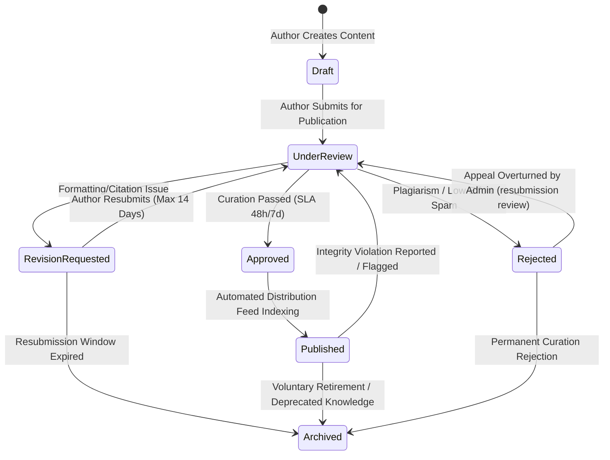
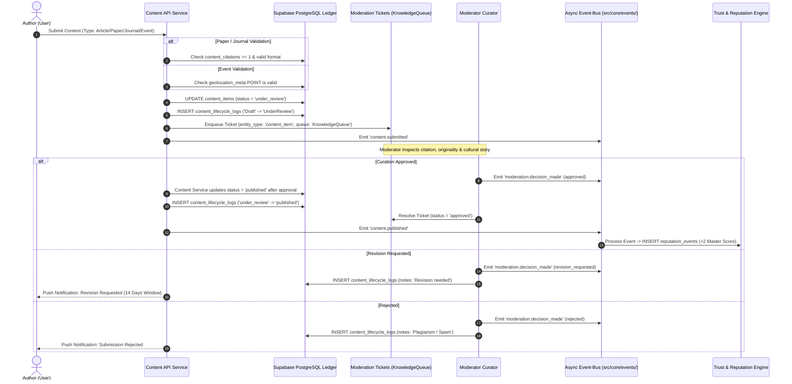

# CONTENT LIFECYCLE MANAGEMENT 

| Metadata | Value |
| :--- | :--- |
| **Dokumen** | `Content Domain (Knowledge Platform Architecture & Curation Pipeline)` | 
| **Versi** | 1.1 |
| **Status** | **In review** | 

---

## 1. CONTENT STATE MACHINE
 
Setiap unit pengetahuan yang dibuat oleh pengguna berstatus `Author` dikendalikan secara mutlak oleh mesin status di bawah ini untuk menjamin kredibilitas dan orisinalitas sebelum diekspos ke publik (*Content Before Commerce Principle*).

### 1.1 Batasan Dampak Operasional Status Konten
*   **Draft**: Konten hanya dapat diakses, dibaca, dan diedit oleh pemilik `author_id`. Konten pada fase ini terisolasi total dari sistem pencarian (*Search Indexer*) dan feed publik.
*   **UnderReview**: Konten dikunci dari proses penyuntingan dan didaftarkan ke `moderation_tickets` pada antrean `KnowledgeQueue`. Tiket kurasi diterbitkan bersama batas waktu peninjauan (*SLA Deadline*).
*   **RevisionRequested**: Konten dikembalikan kepada Author untuk perbaikan. Menyertakan catatan evaluasi kurator (`feedback_notes`) dan batas waktu perbaikan maksimal **14 hari kalender**.
*   **Approved**: Konten lolos kurasi kelayakan ilmiah dan kebudayaan. Sistem menghitung bobot keterkaitan dengan Marketplace (`knowledge_backed_multiplier`).
*   **Published**: Konten terekspos penuh ke publik, terindeks dalam mesin pencarian platform, dan memicu penambahan poin reputasi Author.
*   **Rejected**: Konten ditolak permanen karena melanggar aturan berat (plagiarisme terbukti, fabrikasi data, atau teks hasil regenerasi AI massal tanpa substansi riset).
*   **Archived**: Konten ditarik dari peredaran publik namun tetap tersimpan permanen dalam basis data sebagai arsip sejarah ekosistem sesuai *Digital Legacy Principle* (`system-context.md §11`).

---

## 2. WORKFLOW PENERBITAN KONTEN & INTEGRITY GATES

Alur penerbitan konten melibatkan koordinasi langsung antara Content Domain, Moderation Domain, dan Event-Bus:

### 2.1 The Citation Mandatory Rule
*   Bagi tipe konten berkategori **Paper** dan **Journal**, sistem menerapkan *constraint validation* yang mewajibkan pengisian entitas tabel `content_citations`.
*   Pengajuan ke status `UnderReview` otomatis digagalkan oleh sistem jika daftar sitasi kosong atau tidak memenuhi format baku yang diakui (`APA`, `MLA`, `PlatformStandard`).

### 2.2 Event Geolocation Enforcements
*   Bagi tipe konten berkategori **Event** (seperti lokakarya keahlian, pameran kriya, atau festival kebudayaan lokal), kolom `geolocation_meta` bertipe data `POINT` **wajib diisi secara valid**.
*   Logika API menolak pembentukan entitas Event tanpa koordinat fisik yang jelas untuk mencegah manipulasi peta promosi dan spam lokasi virtual.

### 2.3 Curation SLA (Batas Waktu Moderasi)
*   **Standard Content (Article & Event)**: Wajib mendapatkan respon kurasi awal dalam jendela waktu maksimal **48 Jam**.
*   **Complex Knowledge (Paper & Journal)**: Melalui peninjauan metodologi mendalam dengan jendela waktu maksimal **7 Hari**.
*   Jika batas waktu terlampaui (*SLA Breach*), sistem secara otomatis mengeksekusi *auto-escalation* ke antrean peninjauan tingkat *Admin Governance*.

---

## 3. CONTENT-TO-COMMERCE INTEGRATION

Sesuai pilar *Content Before Commerce* (`system-context.md §9`):

1.  **Item Story Attribution**: Konten riset dan artikel sejarah daerah dapat ditautkan ke produk fisik melalui `catalog_provenances.cultural_attribution_meta`, berisi hanya ID referensi konten.
2.  **Knowledge-Backed Multiplier**: Produk ritel/grosir yang memiliki rujukan riset atau artikel terverifikasi memperoleh peningkatan bobot `knowledge_backed_multiplier` (skala 1.00 – 2.00) pada tabel `catalog_items`, yang meningkatkan peringkat keterlihatan produk dalam mesin pencarian katalog.

---

## 4. IMMUTABLE LIFECYCLE LOGGING & EVENT BUS INTEGRATION

Setiap mutasi kondisi konten wajib meninggalkan jejak transparan untuk keperluan akuntabilitas data:

*   **Ledger Penyimpanan**: Setiap perubahan status wajib mencatatkan entri baru ke tabel `content_lifecycle_logs`:
    *   `id`: Primary key log unik (`UUID DEFAULT gen_random_uuid()`).
    *   `content_id`: UUID materi konten yang dimutasi.
    *   `actor_id`: UUID pengguna/kurator/sistem yang mengeksekusi mutasi.
    *   `old_state`: Status sebelumnya (`VARCHAR(50)`, lowercase snake_case).
    *   `new_state`: Status sesudahnya (`VARCHAR(50)`, lowercase snake_case).
    *   `rationale_notes`: Catatan evaluasi / umpan balik kurator (`TEXT`).
    *   `timestamp`: Waktu pencatatan mutasi (`TIMESTAMPTZ DEFAULT now()`).
*   **Async Event-Bus Contract**:
    *   `content.submitted`: Diterbitkan Content saat status beralih dari `draft` ke `under_review`.
    *   `content.published`: Diterbitkan Content setelah menerima `moderation.decision_made` dan menyimpan status `published`; memicu penambahan skor merit (`+2`) pada Reputation.
    *   `content.flagged`: Diterbitkan saat konten dilaporkan oleh komunitas dan masuk kembali ke `KnowledgeQueue` untuk investigasi ulang.
Status lifecycle database pada dokumen ini memakai `lowercase_snake_case`; nama PascalCase pada diagram hanya label presentasi. Banding tidak menulis Content secara langsung: Admin mencatat putusan, lalu Content menerapkan perubahan status melalui layanan owner.
