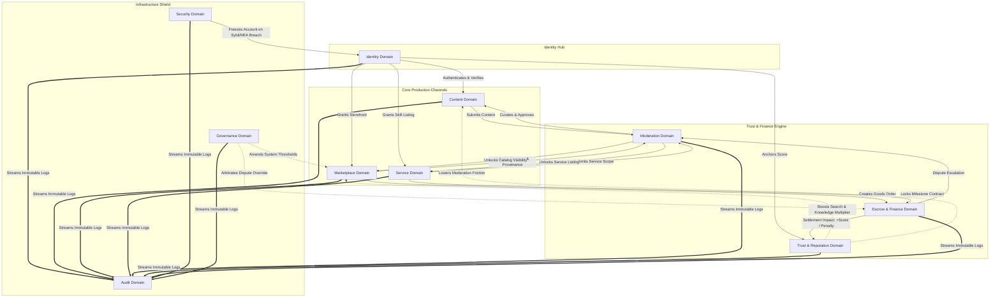

# DOMAIN MAP & BOUNDED CONTEXTS

Status Document: Selaras untuk review | VERSION: 1.5
Domain Level: High-Level Architecture Implementation Design
Tech Stack Baseline: Supabase PostgreSQL (Relational Master Ledger) | Redis (Cache) | Meilisearch (Search) | Google Cloud API

---

## 1. STRATEGIC DOMAIN OVERVIEW

Dokumen ini memetakan batasan fungsional (Bounded Context) dari sistem Racik Media V3. Setiap domain memiliki tanggung jawab tunggal (Single Source of Truth) dan merangkum entitas serta aturan logika bisnis yang diamanatkan oleh konstitusi `.ai-context/`.



> [!NOTE]
> **Catatan Arsitektur - Social Ecosystem Domain**: Forum, grup, feed, Private Chat, dan Vendor Chat dirilis pada V3.1 (Phase 3). Order Chat dan Support Chat dirilis bersama Commerce pada V3.0 (Phase 2) untuk mendukung bukti transaksi dan sengketa. Peta ini mengelompokkan bounded context tingkat atas; jumlah domain granular mengikuti `data-ownership.md`.

---

## 2. DETAIL BATASAN DOMAIN (BOUNDED CONTEXT DICTIONARY)

### 2.1 Identity Domain (Pilar Akuntabilitas Akun Utama)
*   **Tanggung Jawab Utama**: Menjamin implementasi *Single Account Policy*. Satu entitas manusia atau badan hukum hanya boleh memiliki satu jangkar identitas global (`user_id`).
*   **Entitas Riil Database**:
    *   `users`: Profil dasar otentikasi.
    *   `user_roles`: Matriks parameter aditif (member, author, seller, distributor, service_provider, moderator, admin).
    *   `individual_profiles`: Profil data spesifik akun perorangan.
    *   `organization_profiles`: Profil data spesifik entitas korporasi, koperasi, atau lembaga (menjamin batas maksimal 80 item dashboard profil).
    *   `organization_representatives`: Manusia akuntabel penanggung jawab sistem badan hukum.
    *   `verifications`: Gerbang validasi berjenjang (KYC tingkat personal & KYB tingkat korporasi).
    *   `verification_documents`: Jejak berkas otentikasi identitas legal (disimpan di bawah enkripsi zero-trust).
    *   `verification_reviews`: Catatan penilaian gerbang verifikasi manual oleh Moderator.

### 2.2 Content Domain (Knowledge Platform Architecture)
*   **Tanggung Jawab Utama**: Mengelola ekosistem pengetahuan lokal, riset, dan artikel kebudayaan sebagai pilar *Content Before Commerce* untuk memfasilitasi pertukaran ilmu yang kredibel.
*   **Entitas Riil Database**:
    *   `content_items`: Materi pengetahuan (Article, Paper, Journal, Event). Menyertakan koordinat wajib untuk tipe Event.
    *   `content_citations`: Validasi rantai referensi penulisan format akademik baku (APA/MLA) untuk menangkal spam teks otomatis.
    *   `content_lifecycle_logs`: Rekaman mutasi status materi dari draf menuju persetujuan publik.

### 2.3 Marketplace Domain (Dual-Channel Commerce)
*   **Tanggung Jawab Utama**: Mengatur infrastruktur katalog produk terpadu untuk jalur transaksi retail langsung (B2C/C2C) dan pengadaan institusional grosir (B2B RFQ).
*   **Entitas Riil Database**:
    *   `catalog_items`: Data produk terpadu ritel dan grosir. Mengunci batasan Supabase storage maksimum 6 gambar (maksimal 5MB per gambar) per item.
    *   `catalog_provenances`: Data cerita asal-usul produk, dimiliki domain Provenance dan direferensikan katalog via ID.
    *   `price_anomaly_registry`: Buku besar pemantauan otomatis untuk mencegah praktik perang harga (*Anti-Price-War*).
    *   `catalog_change_logs`: Log pelacakan perubahan data harga, stok, dan klasifikasi produk.

### 2.4 Service Domain (Professional & Geolocated Skills Hub)
*   **Tanggung Jawab Utama**: Memfasilitasi perdagangan keahlian profesional yang dibagi menjadi pengiriman digital jarak jauh (Remote) dan koordinasi fisik lokal (Geolocated).
*   **Entitas Riil Database**:
    *   `service_listings`: Katalog keahlian penyedia jasa lengkap dengan batas radius dan titik koordinat operasi pusat (`base_location`).
    *   `service_milestones`: Struktur target pengerjaan dengan batasan perlindungan batas maksimal revisi (maksimal 3 kali).
    *   `service_presence_tokens`: Bukti validasi kehadiran lapangan (Check-in koordinat, QR Scan, Geofence match).
    *   `provider_performance_logs`: Read model performa dari domain Service-Performance.
    *   `service_change_logs`: Jejak audit modifikasi lingkup kerja dan harga jasa.

### 2.5 Escrow & Finance Domain (Isolated Ledger Model)
*   **Tanggung Jawab Utama**: Mengatur alur dana transaksi yang diisolasi langsung per pesanan via kontrak khusus tanpa penampungan saldo internal platform (*No-Wallet Financial Architecture*).
*   **Entitas Riil Database**:
    *   `orders`: Kontrak komitmen komersial bilateral pembeli dan penjual dilengkapi status operasional.
    *   `order_items`: Detail pelacakan item produk atau jasa spesifik per pesanan tunggal.
    *   `escrow_contracts`: Status penguncian dana aktual termasuk status akhir pembatalan/pengembalian (*Refunded/Cancelled*).
    *   `escrow_settlement_splits`: Perhitungan pembagian dana otomatis untuk payout vendor dan alokasi infrastruktur platform (*Sustainability Model*).
    *   `escrow_events`: Log kronologis append-only penanda setiap perubahan status finansial.

### 2.6 Trust & Reputation Domain (Append-Only Merit Engine)
*   **Tanggung Jawab Utama**: Menghitung bobot integritas master pengguna secara lintas-peran (*Trust Spillover Protocol*). Sistem mengabaikan metrik kesenangan sosial kosmetik (seperti tombol Suka atau hitungan Pengikut).
*   **Entitas Riil Database**:
    *   `core_reputations`: Skor total agregasi tingkat kepercayaan identitas pengguna.
    *   `reputation_events`: Log penambahan atau penalti poin yang bersifat *append-only* (tidak dapat diubah).
    *   `reputation_decay_logs`: Riwayat penalti otomatis akibat pasivitas akun pengguna > 6 bulan.

### 2.7 Moderation Domain (Collaborative Curation Engine)
*   **Tanggung Jawab Utama**: Menjadi pintu gerbang kurasi wajib sebelum entitas digital (konten, katalog, kenaikan peran) terekspos ke publik.
*   **Entitas Riil Database**:
    *   `moderation_tickets`: Antrean kasus masuk (`KnowledgeQueue`, `CatalogQueue`, `ServiceQueue`, `IdentityQueue`).
    *   `moderation_assignments`: Alokasi tiket serta penegakan batas waktu respon kurator (SLA).
    *   `moderation_panel_reviews`: Konsensus peninjauan pelanggaran berat yang membutuhkan minimal 3 suara Moderator.
    *   `moderation_panel_votes`: Log kunci pilihan suara individual moderator secara transparan untuk mencegah kecurangan *voting* ganda.
    *   `appeal_tickets`: Saluran banding pengguna atas keputusan penolakan moderator dalam jendela waktu maksimal 7 hari.

### 2.8 Security Domain (Zero-Trust Monitoring Infrastructure)
*   **Tanggung Jawab Utama**: Menegakkan perimeter keamanan tingkat tinggi, deteksi anomali siber, dan menghentikan manipulasi akun massal (Sybil Attack).
*   **Entitas Riil Database**:
    *   `security_incidents`: Rekaman kegagalan MFA beruntun, ketidakcocokan geolokasi sesi, atau anomali perangkat.

### 2.9 Governance Domain (Administrative Arbitration Infrastructure)
*   **Tanggung Jawab Utama**: Mencatat keputusan regulasi tertinggi dan intervensi polimorfik terhadap parameter global oleh peran Admin.
*   **Entitas Riil Database**:
    *   `governance_decisions`: Log perubahan koefisien tarif keberlanjutan global dan parameter batas bawah harga yang wajib merujuk pada berkas dokumentasi Architecture Decision Record (ADR).

### 2.10 Audit Domain (Platform Absolute Logs)
*   **Tanggung Jawab Utama**: Menyediakan penyimpanan log spesifik domain yang terpisah dan bersifat *immutable* demi transparansi forensik data platform secara mutlak.
*   **Sub-Log yang Diwajibkan Konstitusi**:
    *   `identity_audit_logs` (Mutasi status akun utama dan peran aditif).
    *   `security_audit_logs` (Gagal otentikasi perimeter, pembongkaran sesi).
    *   `moderation_audit_logs` (Catatan penolakan kurator, log rotasi kuartalan kurator).
    *   `financial_audit_logs` (Pecahan transfer split settlement, bukti pencairan dana escrow).
    *   `logistics_change_logs` berada di domain Logistics; Audit menyimpan referensi event, bukan menulis tabel Logistics.

---

## 3. DOMAIN INTERACTION BOUNDARIES (CROSS-FEATURE COUPLING)

Sesuai dengan ketentuan ketat konstitusi arsitektur, komunikasi lintas domain **dilarang keras menggunakan pemanggilan folder internal secara langsung**. Interaksi wajib menggunakan dua jalur resmi:

### 3.1 Public API Barrel Export (`src/features/<feature-name>/index.ts`)
Setiap domain hanya boleh mengekspos tipe (*types*), komponen UI publik, dan fungsi kueri baca (*read-only selectors*) yang telah disetujui. Struktur internal (`internal/`, `components/private/`, `services/private/`) bersifat terisolasi dan tidak boleh diimpor oleh fitur lain.

### 3.2 Async Event-Bus Architecture (`src/core/events/`)
Mutasi status lintas-domain yang berdampak pada domain lain **wajib** melalui pola asinkronus *Publish-Subscribe* menggunakan skema payload standar:

```typescript
export interface DomainEvent<T = unknown> {
  eventId: string;           // UUIDv4 unik untuk setiap pesan log event
  correlationId: string;     // UUIDv4 pengikat rantai proses hulu-ke-hilir
  aggregateId: string;       // UUIDv4 ID entitas utama yang bermutasi (misal: order_id)
  eventType: string;         // Nama wire DOMAIN_ACTION yang diturunkan dari domain.action
  timestamp: string;         // ISO-8601 UTC timestamp
  actorId: string;           // UUID pengguna / sistem pemicu
  payload: T;                // JSON camelCase; ID rujukan dan data minimum non-sensitif
  metadata?: Record<string, unknown>;
}
```

### 3.3 Katalog Resmi Event Domain

Satu-satunya daftar nama event, publisher, consumer, dan payload adalah `event-map.md`. Dokumen ini tidak menggandakan katalog agar tidak menyimpang. Moderation hanya menerbitkan `moderation.decision_made`; domain pemilik entitas menerapkan putusan pada datanya sendiri dan menerbitkan event bisnis.

### 3.4 Batasan Pelanggaran Keras (Strict Prohibitions)
1. **Dilarang Direct Database Mutation Lintas Domain**: Domain `Marketplace` tidak boleh mengeksekusi `UPDATE escrow_contracts`. Semua mutasi finansial wajib memanggil endpoint/event resmi domain `Escrow`.
2. **Dilarang Bypass Curation**: Tidak ada jalur langsung (*bypass*) bagi produk atau konten untuk tayang tanpa melalui tiket `Moderation Domain`.
3. **Dilarang Internal Pooling**: Tidak boleh membuat tabel saldo dompet terpusat (*platform wallet*); seluruh aliran dana wajib terlacak pada relasi 1-to-1 pesanan (`orders` $\leftrightarrow$ `escrow_contracts`).


## 4. PEMETAAN KE DOMAIN GRANULAR (ADR-001 D1)

| Domain tingkat atas `domain-map` | Domain granular `data-ownership` |
| :--- | :--- |
| Identity & Access | Identity, Membership |
| Vendor | Vendor |
| Knowledge / Content | Content |
| Marketplace | Marketplace, Provenance |
| Service | Service-Marketplace, Service-Performance |
| Commerce & Finance | Order, Payment, Escrow |
| Logistics | Logistics |
| Community & Communication | Community, Chat, Notification |
| Trust & Operations | Reputation, Review, Analytics |
| Safety & Control | Moderation, Security, Governance, Audit |
| Search | Search (read model; konsumsi event) |

Nama folder fitur menggunakan `kebab-case` (mis. `src/features/service-marketplace/`). Domain granular, kepemilikan entitas, dan jadwal fase/versi mengikuti `data-ownership.md` dan `release-versioning.md`. Order Chat dan Support Chat masuk Commerce (V3.0/Phase 2); fitur sosial lain masuk Community (V3.1/Phase 3).
