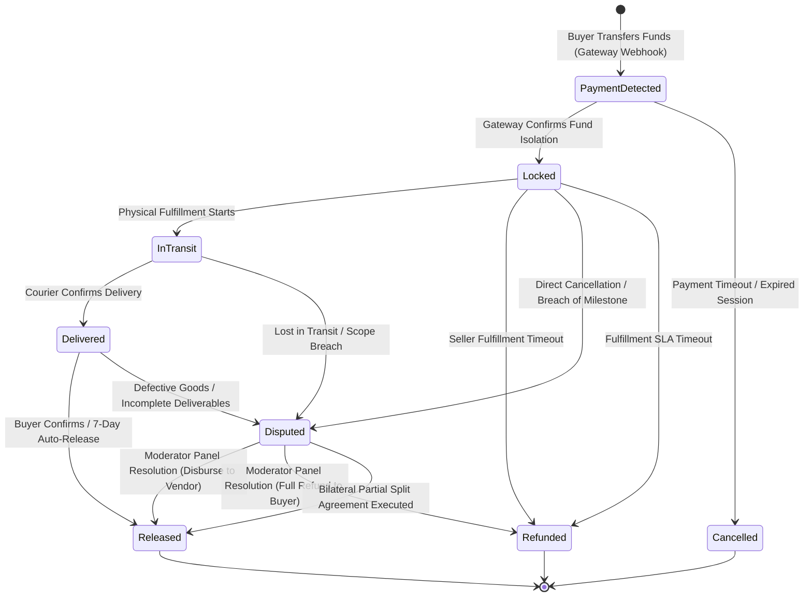

# ESCROW & FINANCIAL LIFECYCLE MANAGEMENT

Status Document: In review | VERSION: 1.1
Domain Context: Escrow & Finance Domain (Isolated Ledger Model & Zero-Wallet Balance)

---

## 1. ESCROW STATE MACHINE (`escrow_contracts.status`)

Setiap aliran dana dari transaksi komersial (Retail, B2B Wholesale, maupun Service) diisolasi penuh per ID pesanan (`order_id`) dan dikendalikan secara mutlak oleh mesin status finansial di bawah ini. Sistem menerapkan prinsip *No-Wallet Financial Architecture* (dilarang keras menyimpan saldo internal).



### 1.1 Batasan Dampak Operasional Status Finansial
*   **PaymentDetected**: Sinyal awal deteksi dana masuk dari payment gateway eksternal (*Virtual Account/Bank Transfer/QRIS*). Pencairan dana keluar diblokir sepihak oleh sistem.
*   **Locked**: Dana dikunci pada satu kontrak per order; jasa bermilestone memakai beberapa tranche pada kontrak yang sama. Tidak ada saldo internal atau pooling.
*   **InTransit**: Status fulfillment fisik dimulai setelah Logistics mengirim event terverifikasi. Jasa mengikuti status tranche milestone dan submission, bukan status `InTransit`.
*   **Delivered**: Pengiriman fisik terkonfirmasi melalui event Logistics. Untuk jasa, timer auto-release dimulai pada submission tiap tranche.
*   **Disputed**: Dana masuk ke mode pembekuan pertahanan (*Financial Freeze Engine*). Seluruh proses pencairan otomatis diputus seketika hingga tercapai putusan panel kurator/moderator dalam jendela waktu SLA 7–14 hari.
*   **Released**: Status akhir pencairan dana. Dana dilepas dari isolasi, memicu pembagian otomatis (*split settlement*) ke rekening bank vendor dan rekening cadangan platform.
*   **Refunded**: Status akhir pengembalian dana 100% secara utuh ke rekening pembeli akibat kegagalan komitmen komersial vendor atau putusan sengketa yang memenangkan pembeli.
*   **Cancelled**: Status pembatalan otomatis sebelum dana sempat dikunci (misal: pembayaran kedaluwarsa atau pesanan ditolak sebelum diproses).

> [!NOTE]
> Prosedur **Partial Split** dicatat sebagai peristiwa `PartialSplitApproved` pada tabel `escrow_events`. Setelah kalkulasi fraksional disepakati secara bilateral, status akhir kontrak tetap beralih ke `Released` dengan rincian pemotongan yang tercatat di `escrow_settlement_splits`.

---

## 2. WORKFLOW ESCROW & SETTLEMENT

Alur penguncian, pengiriman, dan pencairan dana pesanan beroperasi secara terpadu lintas domain:

```mermaid
sequenceDiagram
    autonumber
    actor Buyer as Buyer (User)
    actor Vendor as Seller / Service Provider
    participant Gateway as Payment Gateway
    participant API as Escrow API Service
    participant DB as Supabase PostgreSQL Ledger
    participant Split as Settlement Split Engine
    participant Bus as Async Event-Bus (src/core/events/)
    participant Audit as financial_audit_logs

    Buyer->>Gateway: Transfer Gross Amount for Order
    Gateway->>API: Webhook: Payment Received
    API->>DB: INSERT escrow_contracts (status = 'locked', order_id UNIQUE)
    API->>DB: INSERT escrow_events ('funds_locked')
    API->>Audit: INSERT financial_audit_logs ('Locked')
    API->>Bus: Emit 'order.escrow_locked'
    
    Note over Vendor: Vendor ships product or executes service
    Vendor->>API: Input resi / mulai jasa (Escrow Service meng-UPDATE status = 'InTransit')
    API->>DB: INSERT escrow_events ('TrackingInserted')
    
    Note over Buyer: Delivery confirmed (physical) / milestone submitted (service)
    API->>DB: Set auto_release_at (physical: 7 days; service tranche: 72 hours)
    API->>DB: INSERT escrow_events ('fulfillment_confirmed')
    
    alt Buyer Confirms (or 7-Day SLA Auto-Release)
        Buyer->>API: Confirm Acceptance (or SLA timer expires)
        API->>DB: INSERT escrow_events ('BuyerConfirmed' / 'AutoReleaseTriggered')
        API->>Split: Calculate Platform Fee & Vendor Payout
        Split->>DB: INSERT escrow_settlement_splits (platform_fee, vendor_payout)
        Split->>Gateway: Disburse Payout to Vendor Bank & Platform Reserve
        API->>DB: UPDATE tranche status = 'released'; release contract after final tranche
        API->>Audit: INSERT financial_audit_logs ('Released', fee_deducted)
        API->>Bus: Emit 'escrow.milestone_released'
    else Dispute Raised (Within 7 Days)
        Buyer->>API: File Dispute Ticket
        API->>DB: UPDATE escrow_contracts (status = 'disputed', dispute_sla_deadline)
        API->>DB: INSERT escrow_events ('DisputeFrozen')
        API->>Bus: Emit 'escrow.disputed'
        Note over API: Moderator Panel investigates (7-14 Days SLA)
    end
```

---

## 3. REQUISITE GOVERNANCE GATES & FINANCIAL PARAMETERS

Tabel `escrow_contracts` dan `escrow_settlement_splits` mengunci logika keuangan di tingkat basis data:

### 3.1 No-Wallet Transaction Isolation Principle
*   Sistem melarang keras keberadaan kolom saldo (`balance`) pada tabel pengguna mana pun. Platform bertindak murni sebagai orkestrator buku besar transaksional (*ledger orchestrator*).
*   Setiap kontrak escrow terikat secara relasional satu-ke-satu (`order_id UNIQUE NOT NULL REFERENCES orders(id)`).
*   Transaksi B2B Wholesale bernilai tinggi wajib melewati gerbang validasi kepatuhan KYB sebelum dana diperbolehkan beralih ke status `Locked`.

### 3.2 The Automatic Split-Settlement Engine (`escrow_settlement_splits`)
Ketika kontrak beralih ke status `Released`, sistem secara simultan mengeksekusi perhitungan matematika sesuai rumus biaya keberlanjutan platform (*Sustainability Model*):
$$\text{Vendor Final Payout} = \text{Gross Amount} - (\text{Gross Amount} \times \text{Platform Fee \%}) - \text{Fixed Gateway Cost}$$
*   `platform_fee_percentage`: Koefisien tarif operasional yang diatur Admin melalui `governance_decisions`; diterapkan sesuai skema governance aktif.
*   `infrastructure_reserve_allocation`: Alokasi cadangan server dan pemeliharaan platform.
*   `vendor_final_payout`: Hak bersih pencairan yang langsung ditransfer ke rekening bank resmi milik vendor.

### 3.3 The SLA Auto-Release Trigger (Jendela 7 Hari)
*   Jika pesanan fisik telah berstatus `Delivered` dan pembeli tidak memberikan konfirmasi maupun sengketa dalam **7 hari kalender (168 jam)**, Escrow mengeksekusi pelepasan tranche terkait. Untuk jasa, timer **72 jam** dimulai ketika milestone berstatus `Submitted`.
*   Peristiwa pelepasan otomatis ini wajib mencatat entri pada `escrow_events` dengan kode rasional dedikasi khusus: `attached_rationale_code = 'SLA_AutoRelease'`.

### 3.4 Dispute Resolution SLA & Trust Impact
*   Setiap sengketa yang memicu status `Disputed` mengaktifkan batas waktu penanganan kurator (`dispute_sla_deadline = now() + INTERVAL '14 days'`).
*   Jika putusan sengketa mewajibkan refund, Escrow mengembalikan jumlah yang ditetapkan dan menerbitkan `escrow.refund_executed`. Penalti reputasi bukan konsekuensi otomatis refund; hanya reason code dan delta yang disetujui pada `reputation-engine.md` yang dapat diterapkan setelah bukti pelanggaran terverifikasi.

---

## 4. IMMUTABLE FINANCIAL AUDIT TRAIL

Setiap mutasi kondisi finansial wajib meninggalkan jejak forensik permanen untuk transparansi tata kelola keuangan:

*   **Ledger Penyimpanan**: Setiap pergerakan dana, mutasi status, dan pemotongan biaya wajib dicatatkan ke dalam tabel **`financial_audit_logs`**:
    *   `id`: Primary key log unik (`UUID DEFAULT gen_random_uuid()`).
    *   `correlation_id`: ID korelasi global penelusuran transaksi (`UUID NOT NULL`).
    *   `escrow_contract_id`: UUID kontrak escrow terkait.
    *   `order_id`: UUID pesanan komersial bilateral.
    *   `amount_locked`: Nilai nominal bruto dana yang dikunci (`DECIMAL(12,2)`).
    *   `fee_deducted`: Nilai nominal potongan biaya platform/gateway (`DECIMAL(12,2)`).
    *   `release_state`: Status akhir pelepasan dana (`Released` / `Refunded`).
    *   `actor_id`: UUID pengguna/admin/sistem yang mengesahkan mutasi.
    *   `timestamp`: Waktu pencatatan mutasi (`TIMESTAMPTZ DEFAULT now()`).
*   **Anti-Mutation Protection**: Operasi manipulasi data finansial dilindungi oleh *trigger constraint* database *append-only*. Perintah `UPDATE` atau `DELETE` pada tabel `financial_audit_logs`, `escrow_events`, dan `escrow_settlement_splits` dilarang keras dan akan ditolak seketika oleh sistem (*System Exception*).
*   **Async Event-Bus Contract**:
    *   `order.escrow_locked`: Diterbitkan saat dana bruto berhasil diamankan di kontrak escrow.
    *   `escrow.milestone_released`: Diterbitkan saat pencairan dana sukses dieksekusi, memicu penambahan poin reputasi.
    *   `escrow.disputed`: Diterbitkan saat pesanan dibekukan akibat sengketa, memicu penugasan panel moderator.
    *   `escrow.refund_executed`: Diterbitkan saat sengketa selesai dengan pengembalian dana penuh ke pembeli dan penalti reputasi ke penjual.


## 5. KETENTUAN REVISI (ADR-001 D5)
* **Model tranche:** Kontrak 1:1 dengan order. Jasa bermilestone memakai tabel `escrow_milestone_tranches` (`escrow_contract_id`, `milestone_id`, `amount`, `status`). `Released` kontrak terjadi setelah tranche terakhir cair; event `escrow.milestone_released` diterbitkan per tranche.
* **Timer auto-release:** fisik 7 hari sejak `Delivered`; jasa 72 jam sejak `Submitted`. `order.escrow_locked` tidak membawa `auto_release_at`.
* **Timeout penjual:** bila Fulfillment SLA (48 jam retail; jadwal RFQ untuk grosir) terlewati tanpa input resi/mulai jasa, kontrak `Locked -> Refunded` dan event `escrow.refund_executed` diterbitkan (tanpa penalti -25, penalti SLA mengikuti `seller_fulfillment_rate`).
* **AML:** order >= Rp100.000.000 ditandai `aml_hold = true` pada kontrak sampai Security/Admin merilis; bukan state baru.
* **Tarif platform:** nilai berasal dari `governance_decisions`, bukan hardcode.
* **Penulis:** hanya Escrow Service yang meng-UPDATE `escrow_contracts`; Vendor/Orders/Logistics mengirim event.


---
