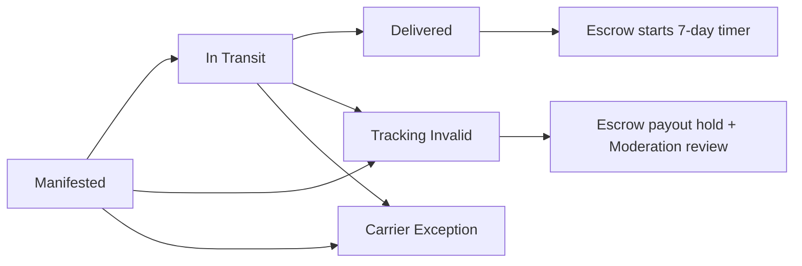
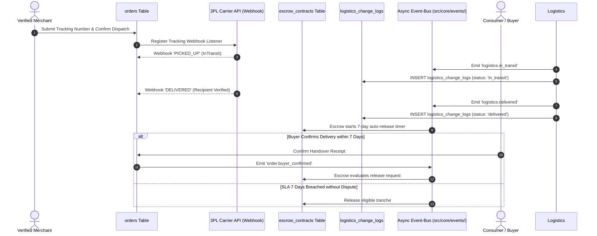

# LOGISTICS & PROVENANCE LIFECYCLE MANAGEMENT

Status Document: Selaras untuk review | VERSION: 1.2
Domain Context: Marketplace & Logistics Domain (Traceability & Custody Framework)

---

## 1. LOGISTICS FULFILLMENT EVENTS

Logistics menyimpan bukti pelacakan dan menerbitkan event fulfillment. Status kontrak, timer, hold, refund, dan payout hanya dimiliki Escrow; tabel Logistics tidak menjadi state machine duplikat.

### 1.1 State Operational Boundaries
*   **Manifested**: Data pengiriman telah dibuat setelah Order berstatus `paid`. Penjual sedang mempersiapkan pengemasan fisik beserta kelengkapan atribut cerita asal-usul barang.
*   **InTransit**: Paket telah diserahkan ke kurir pihak ketiga yang terintegrasi (JNE, J&T, SiCepat, Pos Indonesia), atau surat jalan pool logistik wholesale telah tervalidasi oleh sistem.
*   **Delivered**: Paket telah diterima menurut bukti provider terverifikasi; event `logistics.delivered` diterbitkan. Escrow memulai timer 7 hari.
*   **Tracking Invalid / Carrier Exception**: Rekaman bukti tracking dibuat dan event dikirim ke Escrow/Moderation. Hanya Escrow yang menahan payout atau menyelesaikan refund; Logistics tidak menetapkan status dana.
*   **Released / Refunded**: Hanya status kontrak Escrow, bukan status logistik.

---

## 2. SEQUENCE DIAGRAM: CARRIER INTEGRATION & PROVENANCE VERIFICATION

---

## 3. TRACEABILITY & AUTHENTICITY GATES

Sistem memvalidasi pergerakan barang bukan hanya sebagai komoditas logistik biasa, melainkan sebagai bukti keaslian produk (*Ecosystem Strategic Asset*):

### 3.1 The Item Story & Provenance Mappings (`catalog_provenances`)
*   Setiap pergerakan logistik produk warisan budaya atau lokal wajib mencatat jejak perpindahan dari Node Produsen Asal (`producer_origin`), melewati Titik Check-in Regional, hingga ke Node Konsumen Akhir.
*   Atribut pada tabel `catalog_provenances` (`producer_origin`, `production_method`, `regional_heritage_story`, `cultural_attribution_meta`) dimiliki Provenance, diverifikasi melalui antrean Moderation sebelum katalog diaktifkan.
*   Katalog dengan cerita asal-usul palsu atau manipulatif yang dilaporkan oleh pembeli akan langsung dijatuhkan sanksi melalui *Trust Spillover Protocol* (-250 poin reputasi).

### 3.2 Predatory Tracking Lockout Engine
*   Sistem menerapkan mesin deteksi otomatis terhadap nomor resi pengiriman. Penginputan nomor resi palsu, daur ulang resi lama, atau manipulasi data manifes pihak ketiga untuk mencairkan dana escrow secara curang akan langsung dicegat oleh sistem.
*   Resi palsu terverifikasi memicu event `logistics.tracking_invalid`; mesin aturan membekukan sementara payout/kapabilitas komersial terkait setelah verifikasi ulang. False positive atau API provider yang tidak tersedia dialihkan ke review manual. Sanksi final dan pemulihan mengikuti `governance-sanction-rules.md`.

### 3.3 Responsible Fulfillment Enforcement
*   Penjual dan distributor wajib memproses pengiriman dalam batas waktu kontrak yang disepakati (*Fulfillment SLA* maksimal 48 jam untuk ritel, sesuai jadwal RFQ untuk grosir).
*   Kegagalan pengiriman berulang, keterlambatan tanpa konfirmasi sistem dinamis, atau penelantaran pesanan secara sepihak akan menurunkan metrik `seller_fulfillment_rate` pada komponen `core_reputations`.

---

## 4. IMMUTABLE LOGISTICS LOGGING (`logistics_change_logs`)

Seluruh riwayat serah terima fisik barang wajib diamankan dalam bentuk log kronologis untuk mencegah manipulasi data pasca pengiriman:

*   **Tabel Ledger**: Setiap perubahan status logistik dicatat sebagai baris data append-only baru pada tabel **`logistics_change_logs`** (sesuai `master-erd.md`):
    *   `id`: Primary key log unik (`UUID DEFAULT gen_random_uuid()`).
    *   `correlation_id`: ID korelasi global penelusuran transaksi (`UUID NOT NULL`).
    *   `order_id`: UUID pesanan terkait (`REFERENCES orders(id)`; tanpa cascade delete).
    *   `tracking_record_id`: ID rekaman detail tracking yang disimpan terenkripsi dan dibatasi aksesnya.
    *   `current_status`: Status logistik (`manifested`, `in_transit`, `delivered`, `carrier_exception`, `tracking_invalid`).
    *   `created_at`: Stempel waktu pencatatan mutasi (`TIMESTAMPTZ DEFAULT now()`).
*   **Anti-Tamper Rule**: Basis data memblokir mutasi berupa `UPDATE` atau `DELETE` pada tabel `logistics_change_logs` demi kepatuhan hukum forensik pengiriman barang.

---

Penalty provenance/logistics tetap memakai reason code dan nilai pada `reputation-engine.md`; logistik tidak memutasi skor secara langsung.
