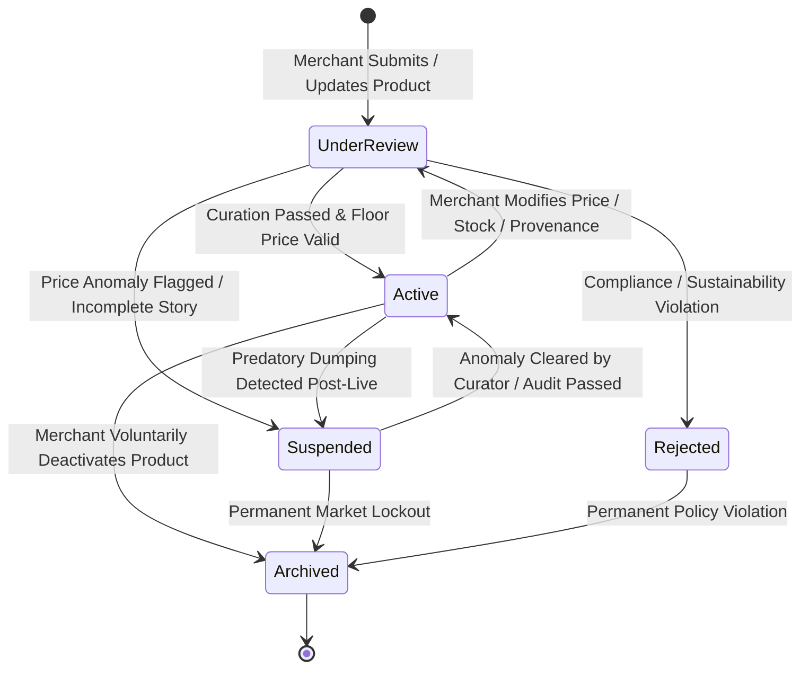

# MARKETPLACE LIFECYCLE MANAGEMENT

Status Document: In review | VERSION: 1.1
Domain Context: Marketplace Domain (Dual-Channel Catalog, Item Story Provenance & Anti-Price-War)

---

## 1. CATALOG ITEM STATE MACHINE (`catalog_items.status`)

Setiap produk yang didaftarkan oleh pengguna berstatus `Seller` atau `Distributor` dikendalikan secara mutlak oleh mesin status di bawah ini untuk menjaga martabat pasar, keaslian asal-usul barang, dan mencegah perang harga destruktif (*Anti-Price-War Directive*).



### 1.1 Batasan Dampak Operasional Status Katalog
*   **UnderReview**: Status wajib bagi setiap penambahan produk baru atau pengubahan parameter harga/spesifikasi. Produk dikunci dari pencarian publik dan didaftarkan ke `moderation_tickets` pada antrean `CatalogQueue`.
*   **Active**: Produk terekspos penuh pada sistem pencarian dan feed discovery platform. Tombol *Direct Checkout* (Retail) atau formulir *Request for Quote / RFQ* (B2B Wholesale) berstatus aktif.
*   **Suspended**: Pemblokiran visibilitas produk secara otomatis (oleh *Price Anomaly Engine*) atau manual oleh kurator karena pelanggaran operasional (seperti indikasi barang tiruan atau dumping harga).
*   **Rejected**: Penolakan langsung di pintu gerbang kurasi karena melanggar kepatuhan hukum, kategori komoditas terlarang, atau pelanggaran etika lingkungan.
*   **Archived**: Penonaktifan produk dari katalog aktif. Data produk tetap tersimpan di basis data untuk menjaga kesinambungan jejak transaksi historis (*Financial & Order Audit Trail*).

---

## 2. WORKFLOW PENDAFTARAN & KURASI PRODUK

Proses kurasi katalog produk melibatkan interaksi terpadu antara Marketplace Domain, Moderation Domain, dan Trust Engine:

```mermaid
sequenceDiagram
    autonumber
    actor Merchant as Seller / Distributor
    participant API as Marketplace API Service
    participant DB as Supabase PostgreSQL Ledger
    participant Engine as Price Anomaly Engine
    participant Queue as Moderation Tickets (CatalogQueue)
    participant Mod as Moderator Curator
    participant Bus as Async Event-Bus (src/core/events/)

    Merchant->>API: Submit Product Listing (Catalog + Provenance + Media)
    API->>DB: Check Seller/Distributor Role State = 'Active'
    API->>DB: Validate Storage Media (Max 6 Images, <= 5MB each)
    API->>DB: Validate Provenance (Origin, Method, Heritage Story)
    API->>Engine: Run Category Floor Price Calculation
    alt Price < Category Floor Price
        Engine->>DB: INSERT price_anomaly_registry (anomaly_status: 'flagged')
        API->>DB: INSERT catalog_items (status: 'suspended')
        API->>Queue: Enqueue Ticket (Severity: 'Major', Queue: 'CatalogQueue')
        API-->>Merchant: Notification: Product Suspended (Predatory Pricing Detected)
    else Price Valid >= Floor Price
        API->>DB: INSERT catalog_items (status: 'under_review')
        API->>DB: Create provenance through Provenance owner contract
        API->>DB: INSERT catalog_change_logs ('Create')
        API->>Queue: Enqueue Ticket (Queue: 'CatalogQueue')
        API->>Bus: Emit 'catalog.submitted'
        
        Note over Queue,Mod: Moderator audits origin story, quality & cultural attribution
        alt Curation Approved
            Mod->>Bus: Emit 'moderation.decision_made'
            Note over API: Marketplace applies approval; Provenance updates its own record via service contract
            Mod->>Queue: Resolve Ticket (status = 'approved')
            API->>Bus: Emit 'catalog.approved'
        else Curation Rejected
            Mod->>Bus: Emit 'moderation.decision_made'
            Note over API: Marketplace applies rejection to its own catalog_items
            Mod->>Queue: Resolve Ticket (status = 'rejected')
        end
    end
```

---

## 3. BUSINESS PRINCIPLES IMPLEMENTATION GATES

Tabel `catalog_items` dan entitas relasinya menegakkan aturan bisnis inti yang dieksekusi secara programatik:

### 3.1 The Item Story Rule (`catalog_provenances`)
Setiap produk dilarang keras hanya berisi spesifikasi teknis komoditas polos. Tabel `catalog_provenances` wajib melampirkan:
*   `producer_origin`: Asal-usul geografis perajin/produsen lokal.
*   `production_method`: Metode pembuatan tradisional, kriya tangan, atau proses manufaktur berkelanjutan.
*   `regional_heritage_story`: Narasi nilai sejarah kebudayaan daerah yang melatarbelakangi produk.
*   `cultural_attribution_meta`: Metadata terstruktur (`JSONB`) yang menghubungkan produk dengan artikel riset di Content Domain.

### 3.2 Anti-Price-War Directive & `price_anomaly_registry`
*   Platform menolak kompetisi banting harga yang merusak ekosistem (*commoditized discount races*).
*   Setiap kali harga produk didaftarkan atau diubah (`PriceUpdate`), sistem membandingkannya dengan batas bawah kategori (`calculated_category_floor`).
* Jika terdeteksi *predatory dumping* (`price < calculated_category_floor`), sistem menahan listing pada status `suspended` dan:
    1.  Mencatat insiden ke tabel `price_anomaly_registry` (`deviation_percentage`, `anomaly_status = 'flagged'`).
    2.  Menerbitkan event `catalog.anomaly_detected` dan tiket `CatalogQueue` severity `major`.
    3.  Menjalankan review panel 3 moderator untuk keputusan final; mesin aturan hanya boleh melakukan freeze sementara.

### 3.3 Dual-Channel Commerce Routing
Platform memisahkan transaksi ritel dan institusional secara tegas:
*   **Retail Channel (`channel_type = 'Retail'`)**:
    *   Mendukung *direct checkout* instan untuk pembeli individual (B2C/C2C).
    *   Menerbitkan pesanan ke tabel `orders` dengan `order_type = 'product_retail'`.
    *   Terintegrasi langsung dengan kalkulasi ongkos kirim dan pelacakan logistik pihak ketiga (`logistics_change_logs`).
*   **B2B Wholesale Channel (`channel_type = 'Wholesale'`)**:
    *   Menonaktifkan tombol *instant checkout*.
    *   Merutekan calon pembeli korporat menuju formulir terstruktur **Request for Quote (RFQ)** untuk negosiasi kuantitas bertingkat, syarat pembayaran termin, dan kontrak pengadaan grosir.
    *   Setelah quotation disepakati, menerbitkan pesanan ke tabel `orders` dengan `order_type = 'product_wholesale'`.

### 3.4 Knowledge-Backed Multiplier
*   Produk yang memiliki kaitan erat dengan publikasi riset atau artikel budaya di Content Domain memperoleh nilai `knowledge_backed_multiplier` (rentang 1.00 hingga 2.00).
*   Multiplier ini berfungsi meningkatkan bobot visibilitas produk dalam algoritma pencarian discovery, mendorong pedagang untuk mengedukasi konsumen melalui pengetahuan sebelum bertransaksi (*Content Before Commerce*).

---

## 4. GRANULAR CATALOG CHANGE LOGGING & EVENT BUS

Setiap mutasi komersial pada produk wajib meninggalkan jejak transparan untuk menghindari manipulasi harga atau stok:

*   **Ledger Penyimpanan**: Setiap mutasi tercatat pada tabel `catalog_change_logs`:
    *   `id`: Primary key log unik (`UUID DEFAULT gen_random_uuid()`).
    *   `catalog_item_id`: UUID katalog yang dimutasi.
    *   `actor_id`: UUID pedagang atau sistem pemicu.
    *   `change_type`: Jenis mutasi (`create`, `price_update`, `stock_depletion`, `metadata_amendment`, `suspension`).
    *   `old_value`: Nilai atribut sebelumnya (`JSONB`).
    *   `new_value`: Nilai atribut sesudahnya (`JSONB`).
    *   `timestamp`: Waktu pencatatan mutasi (`TIMESTAMPTZ DEFAULT now()`).
*   **Media Storage Constraint**: Batas maksimal media visual per item produk di Supabase Storage adalah **6 gambar** (maksimal 5MB per gambar) dalam format yang dioptimasi (*WebP/JPEG*).
*   **Async Event-Bus Contract**:
    *   `catalog.submitted`: Diterbitkan saat produk baru atau revisi diajukan ke antrean kurasi.
    *   `catalog.approved`: Diterbitkan Marketplace setelah menerima keputusan Moderation dan memperbarui katalog.
    *   `catalog.anomaly_detected`: Diterbitkan Marketplace saat mesin mendeteksi anomali dan menahan listing sementara.
Perubahan stok rutin tidak mengirim ulang item ke `UnderReview`; perubahan harga, provenance, dan spesifikasi material mengirim revisi ke kurasi. Semua perubahan tetap dicatat di `catalog_change_logs`.
