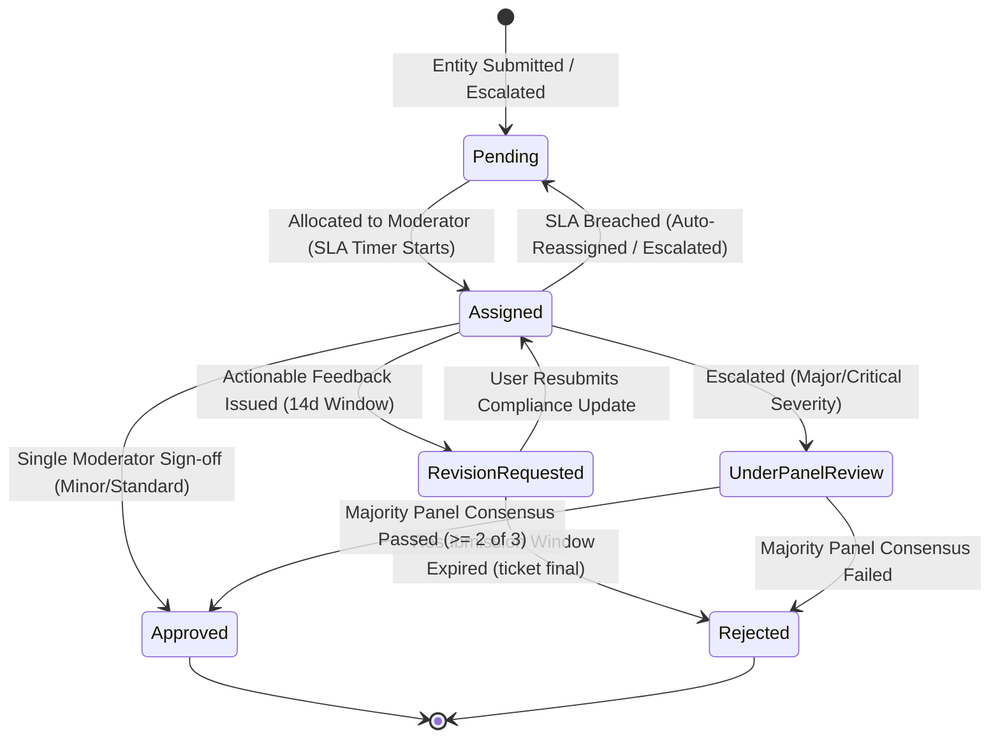
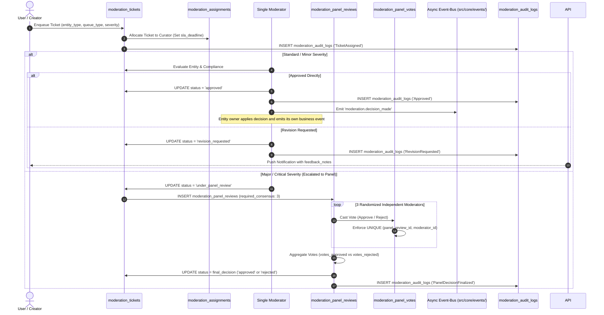
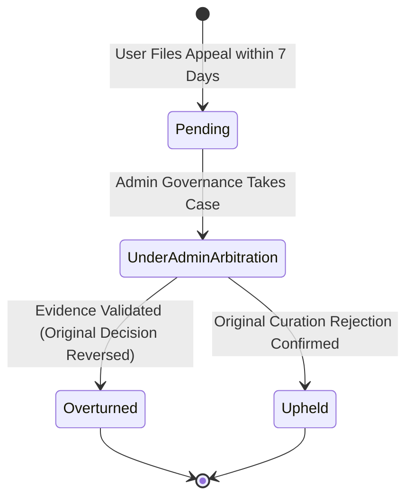

# MODERATION LIFECYCLE MANAGEMENT

Status Document: In review | VERSION: 1.1
Domain Context: Moderation Domain (Collaborative Curation Engine & Consensus Voting)

---

## 1. MODERATION TICKET STATE MACHINE (`moderation_tickets.status`)

Setiap entitas digital yang didaftarkan ke platform (Konten, Produk, Jasa, Perubahan Peran, atau Sengketa Escrow) wajib melewati gerbang kurasi terpusat dan dikendalikan oleh mesin status tiket di bawah ini:

### 1.1 Batasan Dampak Operasional Status Tiket
*   **Pending**: Tiket baru masuk ke salah satu dari 4 antrean utama (`KnowledgeQueue`, `CatalogQueue`, `ServiceQueue`, `IdentityQueue`). Tiket berstatus anonim dan siap diambil oleh kurator yang memenuhi syarat kompetensi peran.
*   **Assigned**: Tiket telah dialokasikan ke seorang Moderator spesifik pada tabel `moderation_assignments`. Menyalakan arloji penghitung batas waktu pemenuhan target layanan (`sla_deadline`).
*   **RevisionRequested**: Kurator memberikan kesempatan perbaikan kepada pemilik entitas. Tiket dikirim kembali ke dasbor pengguna bersama catatan evaluasi terstruktur (`feedback_notes`).
*   **UnderPanelReview**: Kasus pelanggaran berat dialihkan ke sistem musyawarah multi-moderator (minimal 3 kurator independen) pada tabel `moderation_panel_reviews` untuk memutus bias personal dan menjamin objektivitas.
*   **Approved**: Keputusan persetujuan kurasi. Membuka akses entitas ke publik, mengaktifkan checkout komersial, atau mengaktifkan peran baru pengguna.
*   **Rejected**: Keputusan penolakan final kurasi. Mengunci entitas dari sistem pencarian publik atau menolak permohonan peran pengguna.
* Tiket untuk fraud, tracking, laporan komunitas, dan sengketa memakai antrean tematik pada `moderation_tickets.queue_type` (`FraudQueue`, `ReportQueue`, `DisputeQueue`); tabel dan owner tetap Moderation.

---

## 2. WORKFLOW KURASI TIKET & PANEL CONSENSUS

Alur evaluasi kurasi tiket melibatkan koordinasi antara entitas pemohon, kurator mandiri, panel konsensus, dan mesin audit:

---

## 3. PIPELINE QUEUES & SLA BOUNDARIES

Sistem mengelompokkan tugas kurasi ke dalam empat antrean terisolasi (`queue_type`) untuk menegakkan spesialisasi dan akuntabilitas:

### 3.1 The Four Mandatory Queues
1.  **KnowledgeQueue**: Memeriksa kredibilitas artikel, kesahihan sitasi akademik (APA/MLA), serta mendeteksi dan menyaring draf hasil regenerasi AI massal tanpa penyuntingan manusia.
2.  **CatalogQueue**: Memeriksa kelengkapan cerita asal-usul barang (*Item Story Rule*), memvalidasi hasil Provenance, serta meninjau anomali harga dari *Price Anomaly Engine*.
3.  **ServiceQueue**: Memeriksa portofolio keahlian, sertifikasi profesional, serta parameter koordinat geofencing bagi penyedia jasa fisik lapangan.
4.  **IdentityQueue**: Memeriksa keabsahan berkas identitas legal personal (KYC) maupun legalitas badan usaha (KYB) sebelum pembukaan hak akses peran aditif diizinkan.

### 3.2 Turnaround Boundaries (SLA) & Auto-Escalation
*   **Tiket Standar (Article, Event, Product Retail, Service Listing)**: Wajib diselesaikan atau diberikan respon balik dalam waktu **48 Jam**.
*   **Tiket Kompleks (Paper, Journal, Aplikasi Distributor B2B)**: Memeriksa dokumen legalitas tebal dengan batas pengerjaan maksimal **7 Hari**.
*   **SLA Breach Prosedur**: Jika kurator membiarkan tiket melewati batas waktu pengerjaan (`now() > sla_deadline`), sistem secara otomatis mencabut hak penanganan kurator tersebut, mengembalikan tiket ke status `Pending`, dan melemparkannya ke antrean prioritas tinggi (*High-Priority Escalation Queue*) untuk di-audit langsung oleh *Admin Governance*.

---

## 4. THE CONSTITUTIONAL APPEAL PATHWAY (`appeal_tickets.status`)

Pengguna yang keberatan atas keputusan penolakan kurator berhak mengajukan permohonan banding konstitusional:

### 4.1 Aturan Penanganan Banding
*   **Jendela Pengajuan 7 Hari**: Pengguna wajib mengajukan banding dalam kurun waktu maksimal **7 hari kalender** sejak tiket kurasi berstatus `Rejected`.
*   **Independensi Arbitrase**: Proses banding otomatis melewati (*bypass*) kurator asal dan ditangani langsung oleh *Admin Governance* pada tabel `appeal_tickets`.
*   **SLA Arbitrase 14 Hari**: Pihak Admin wajib menuntaskan investigasi dan memberikan pernyataan putusan resmi (`governance_notes`) dalam waktu maksimal **14 hari kerja**.
*   **Konklusi Banding**:
    *   `Overturned`: Keputusan penolakan dianulir. Owner domain memindahkan entitas ke `under_review` untuk menerapkan putusan dan memeriksa kondisi saat ini; konten tidak auto-publish. Reputation mencatat event pembalik tanpa menghapus penalti lama.
    *   `Upheld`: Keputusan penolakan awal dikukuhkan sebagai putusan inkrah final yang mengikat.

---

## 5. IMMUTABLE MODERATION AUDIT TRAIL & EVENT BUS

Seluruh riwayat evaluasi kurasi dikunci secara forensik untuk mencegah kolusi atau penyalahgunaan wewenang:

*   **Ledger Penyimpanan**: Setiap mutasi tercatat pada tabel **`moderation_audit_logs`**:
    *   `id`: Primary key log unik (`UUID DEFAULT gen_random_uuid()`).
    *   `moderation_ticket_id`: UUID tiket kurasi terkait (`REFERENCES moderation_tickets(id)`).
    *   `actor_id`: UUID kurator atau admin penilai (`REFERENCES users(id)`).
    *   `action_type`: Tipe tindakan (`TicketAssigned`, `RevisionRequested`, `Approved`, `Rejected`, `PanelVoteCast`, `AppealResolved`).
    *   `rationale_notes`: Umpan balik evaluasi / justifikasi putusan (`TEXT`).
    *   `timestamp`: Waktu pencatatan mutasi (`TIMESTAMPTZ DEFAULT now()`).
*   **Anti-Mutation Protection**: Operasi manipulasi data kurasi dilindungi oleh *trigger constraint* database *append-only*. Perintah `UPDATE` atau `DELETE` pada tabel `moderation_audit_logs` dan `moderation_panel_votes` dilarang keras dan akan ditolak seketika oleh sistem (*System Exception*).
*   **Async Event-Bus Contract**:
    *   `content.published`: Diterbitkan saat tiket artikel disetujui, memicu penambahan skor merit (+2) ke Author.
    *   `catalog.approved`: Diterbitkan saat tiket produk disetujui, membuka visibilitas publik di katalog.
    *   `service.approved`: Diterbitkan saat tiket listing keahlian disetujui.
    *   `identity.role_activated`: Diterbitkan saat verifikasi KYC/KYB disetujui, mengaktifkan hak peran baru pengguna.
    *   `escrow.refund_executed`: Diterbitkan Escrow saat refund terkonfirmasi; Reputation hanya memproses penalti terverifikasi dengan reason code yang ditetapkan Governance.
Antrean tidak memiliki tabel bisnis terpisah. Hasil kurasi adalah keputusan Moderation; perubahan entitas dan event domain selanjutnya selalu menjadi tanggung jawab owner.
