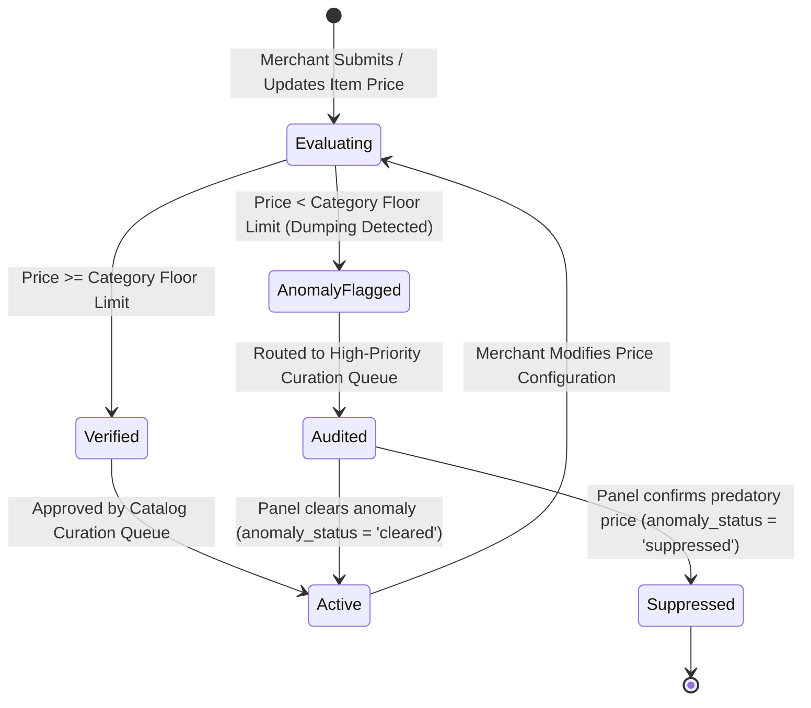
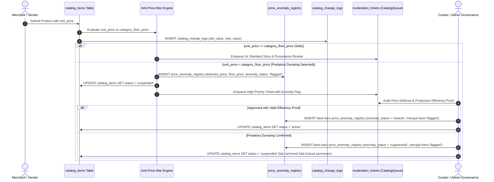

# PRICING & SUSTAINABILITY LIFECYCLE MANAGEMENT

Status Document: In review | VERSION: 1.1
Domain Context: Pricing & Finance Domain (Anti-Price-War & Sustainability Fee Architecture)

---

## 1. PRICING STATUS & ANOMALY STATE MACHINE

Setiap harga produk atau jasa yang didaftarkan ke dalam katalog sistem wajib melewati mesin status otomatis di bawah ini untuk mendeteksi praktik predatory dumping (*Anti-Price-War Directive*) sebelum listing diaktifkan:

### 1.1 State Operational Boundaries
*   **Evaluating**: Fase evaluasi matematis instan oleh database engine ketika mendeteksi input harga baru atau modifikasi nilai harga katalog.
*   **Verified**: Harga dinyatakan wajar dan berada di atas atau sama dengan ambang batas minimum kategori industri lokal (`category_floor_price`).
*   **AnomalyFlagged**: Sistem menahan visibilitas produk (`catalog_items.status = 'suspended'`) dan mencatatkan penyimpangan ke `price_anomaly_registry(anomaly_status = 'flagged')`.
*   **Audited / Suppressed**: Intervensi kurasi tata kelola. Jika terbukti sengaja melakukan perang harga predator untuk mematikan perajin lokal, status anomali diubah menjadi `Suppressed`, listing dikunci permanen, dan reputasi pedagang dipotong masif via *Trust Spillover Protocol*.

---

## 2. SEQUENCE DIAGRAM: PRICE EVALUATION & CURATION AUDIT

---

## 3. ANTI-PRICE-WAR ENGINE & SUSTAINABILITY FEE RULES

Sistem mengunci keadilan pasar secara terprogram melalui penegakan batas matematika operasional:

### 3.1 The Dynamic Floor Price Engine Validation
*   Batas bawah harga (`category_floor_price`) dihitung secara otomatis berdasarkan agregasi makro ekonomi regional (inflasi daerah, harga bahan baku komoditas lokal, dan standar upah buruh adil) yang diperbarui secara resmi **setiap 6 bulan** oleh Admin Governance.
*   Mesin pencari platform secara mutlak **dilarang keras** menyediakan algoritma pengurutan harga dari yang termurah (*Sort by Lowest Price Restrictions*) untuk menjaga martabat nilai produk kerajinan dan komoditas lokal.

### 3.2 Deceptive Discount Mitigation
*   Sistem memblokir otomatis diskon palsu manipulatif (menaikkan harga drastis lalu memberikan diskon fiktif) dengan memvalidasi riwayat stabilitas harga produk pada tabel `catalog_change_logs` selama minimal **30 hari ke belakang**.
*   Potongan diskon promosi tidak diizinkan menembus batas bawah kategori (`category_floor_price`) dalam kondisi apa pun.

### 3.3 Sustainability Split Settlement Execution
*   Platform memungut komisi berkelanjutan yang transparan dan non-ekstraktif pada saat escrow bertransisi menuju status `Released`.
*   **Formula Jalur Retail (B2C/C2C)**: 
    $$\text{Final Payout} = \text{Gross Amount} - (\text{Gross Amount} \times 0.05) - \text{Fixed Payment Gateway Fee}$$
    *(Fee retail default 5%; nilai dapat diubah Admin Governance via governance_decisions, bukan hardcode).*
* **Jalur Grosir (B2B RFQ)**: Tarif berdasar nilai total kontrak grosir:
    * Di bawah Rp 10.000.000: **3.5%**
    *   Rp 10.000.000 - Rp 50.000.000: **3.5%**
    *   Rp 50.000.001 - Rp 250.000.000: **2.5%**
        * > Rp 250.000.000: **1.5%**
    * **Jasa:** tarif dasar **5%** dari setiap tranche yang berhasil dicairkan, ditambah biaya gateway aktual bila berlaku. Seluruh tarif dapat diubah hanya melalui `governance_decisions`; perubahan berlaku untuk kontrak baru dan tidak mengubah kontrak yang sudah dikunci.
    * **Tiket anomali:** Severity `major` dan keputusan akhir melalui panel 3 moderator sesuai `moderation-lifecycle.md`; aturan otomatis hanya menahan listing sementara.

---

## 4. IMMUTABLE PRICING & ANOMALY LOGGING

Setiap mutasi harga dan catatan anomali dilindungi secara forensik di tingkat basis data:

*   **Tabel Anomali (`price_anomaly_registry`)**:
    *   `id`: Primary key unik (`UUID DEFAULT gen_random_uuid()`).
    *   `catalog_item_id`: UUID produk terkait (`REFERENCES catalog_items(id)`).
    *   `detected_price`: Nilai harga yang dicoba didaftarkan (`DECIMAL(12,2)`).
    *   `category_floor_price`: Ambang batas bawah harga saat evaluasi (`DECIMAL(12,2)`).
    *   `anomaly_status`: Status penanganan (`flagged`, `cleared`, `suppressed`).
    *   `flagged_at`: Waktu deteksi sistem (`TIMESTAMPTZ DEFAULT now()`).
*   **Tabel Perubahan Katalog (`catalog_change_logs`)**:
    *   `id`: Primary key log unik (`UUID DEFAULT gen_random_uuid()`).
    *   `catalog_item_id`: UUID produk terkait (`REFERENCES catalog_items(id)`).
    *   `changed_by`: UUID pengguna/pedagang yang melakukan perubahan (`REFERENCES users(id)`).
    *   `old_value`: Rekaman harga/data lama dalam format `JSONB`.
    *   `new_value`: Rekaman harga/data baru dalam format `JSONB`.
    *   `timestamp`: Waktu pencatatan mutasi (`TIMESTAMPTZ DEFAULT now()`).
*   **Defensive Security Enforcement**: Setiap upaya `UPDATE` atau `DELETE` data pada tabel riwayat perubahan harga dan registri anomali akan langsung ditolak oleh trigger blocker basis data demi menjamin transparansi jangka panjang.
