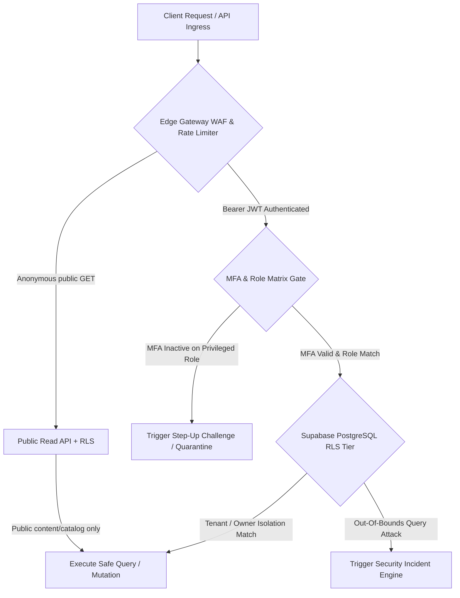

# ZERO-TRUST SECURITY ARCHITECTURE

Status Document: In review | VERSION: 1.1
Domain Context: Security Domain (Zero-Trust Infrastructure & Autonomous Incident Response)

---

## 1. ZERO-TRUST ACCESS PERIMETER & DEFENSE TIERS

Sistem Racik Media V3 mengadopsi arsitektur keamanan **Zero-Trust Baseline**. Setiap permintaan API, interaksi lintas domain, atau akses data administratif wajib diverifikasi, diotorisasi secara kriptografis, dan diaudit tanpa pengecualian hak istimewa (*no privileged shortcuts*).



### 1.1 Core Security Boundaries
*   **Data Isolation Mandate**: Seluruh penyimpanan data sensitif (dokumen mentah KYC/KYB, sidik jari perangkat, kunci kriptografi pesanan, dan dokumen legal perwakilan) wajib diisolasi secara fisik dan logis dari lapisan presentasi umum melalui Supabase Row-Level Security (RLS).
*   **Token Lifecycle & Device Binding**:
    *   *Access Token*: Masa berlaku maksimal **15 Menit** (disertai enkripsi HMAC SHA-256).
    *   *Refresh Token*: Masa berlaku maksimal **7 Hari** dengan rotasi token tunggal (*Single-Use Refresh Token Rotation*).
    *   *Device Fingerprinting*: Token diikat ke sidik jari perangkat klien (*User-Agent* + IP Geo Pool). Perubahan mendadak otomatis memicu pembatalan token.

---

## 2. MULTI-FACTOR AUTHENTICATION & STEP-UP VERIFICATION

Otentikasi bertugas membuktikan identitas, sementara otorisasi membatasi kapabilitas sistem.

### 2.1 Mandatory MFA Enforcements (`users.mfa_enabled`)
*   Implementasi *Multi-Factor Authentication (MFA)* bersifat **wajib programmatik** (`mfa_enabled = TRUE`) bagi seluruh akun yang memegang peran aditif aktif: `Author`, `Seller`, `Distributor`, `ServiceProvider`.
*   Bagi akun administratif (`Moderator`, `Admin`), penegakan MFA bersifat mutlak. Basis data menolak penerbitan sesi atau pembaruan tiket kurasi jika parameter `mfa_enabled` bernilai `FALSE`.

### 2.2 Dynamic Step-Up Verification Triggers
Sistem memicu tantangan otentikasi faktor kedua secara dinamis (*Step-Up Challenge*) ketika pengguna melakukan aksi berkategori *High-Risk Mutations*:
1.  **Pembaruan Rekening Pencairan**: Mengubah nomor rekening bank tujuan pencairan dana escrow (No-Wallet Architecture).
2.  **Perubahan Kredensial Kritis**: Mengubah alamat email primer atau nomor telepon pada profil jangkar identitas tunggal.
3.  **Step-up Authentication**: Mengonfirmasi aksi berisiko tinggi (mis. rekening atau kontrak di atas Rp 50.000.000); ini hanya verifikasi identitas tambahan, bukan AML hold.
4.  **AML Review**: Transaksi tunggal atau akumulatif >= Rp 100.000.000 memicu `aml_hold` pada kontrak Escrow sampai Security/Admin menyelesaikan review. Batas ini terpisah dari ambang step-up.

---

## 3. THREAT TELEMETRY & INCIDENT RESPONSE LIFECYCLE

Sistem menerapkan mesin pemantauan telemetri real-time untuk mendeteksi anomali perilaku sesi, serangan *credential stuffing*, dan manipulasi multi-akun (Sybil attack):

```mermaid
sequenceDiagram
    autonumber
    participant Client as Malicious / Anomaly Client
    participant Gateway as API Gateway / Telemetry
    participant SecEngine as Security Incident Engine
    participant SecIncidents as security_incidents
    participant SecAudit as security_audit_logs
    participant UserLedger as users & roles
    participant GovAdmin as Governance & Admin Arbitrator

    Client->>Gateway: Repeated MFA Failures / Impossible Travel Geo Anomaly
    Gateway->>SecEngine: Trigger Anomaly Alert (user_id, source_ip, metadata)
    SecEngine->>SecIncidents: INSERT security_incidents (type: 'GeoAnomaly', severity: 'Critical', status: 'Open')
    SecEngine->>SecAudit: INSERT security_audit_logs (action_type: 'IncidentDetected')
    
    rect rgb(255, 230, 230)
        Note over SecEngine,UserLedger: Autonomous Lockdown Protocol
        SecEngine->>UserLedger: Invalidate All Active Refresh Tokens
        SecEngine->>UserLedger: Emit 'security.incident_critical'
        Note over UserLedger: Identity Service mengevaluasi event dan memperbarui status miliknya
        SecEngine->>SecAudit: INSERT security_audit_logs (action_type: 'AccountLocked')
    end

    SecEngine->>GovAdmin: Route to Admin Arbitration Queue
    GovAdmin->>GovAdmin: Investigate Forensics & Contact User
    GovAdmin->>SecIncidents: Security owner updates incident_status = 'mitigated'
    GovAdmin->>UserLedger: Governance records decision; Identity restores status after Admin approval
```

### 3.1 Telemetry Classification Matrix (`security_incidents`)
Setiap insiden keamanan dikelompokkan berdasarkan tipe dan tingkat keparahan (*severity*) pada tabel **`security_incidents`**:

| Incident Type (`incident_type`) | Tingkat Keparahan (`severity_level`) | Indikator Pemicu Deteksi | Tindakan Otomatis Sistem |
| :--- | :--- | :--- | :--- |
| `MFAFailure` | Medium | Gagal verifikasi MFA sebanyak 5 kali berturut-turut dalam 10 menit. | Kunci sementara input MFA selama 30 menit. |
| `CredentialStuffing` | High | Lonjakan percobaan login dari IP address yang sama ke berbagai akun. | Blokir IP di level edge gateway (WAF Drop). |
| `DeviceMismatch` | Medium | Sesi aktif menggunakan user-agent atau header cipher yang tidak dikenal. | Wajibkan verifikasi email challenge. |
| `GeoAnomaly` | Critical | *Impossible travel anomaly* (sesi aktif bersamaan di dua lokasi geografis berbeda > 500 km dalam rentang < 1 jam). | Batalkan token, terbitkan `security.incident_critical`; Identity boleh menerapkan `under_review` sementara. |
| `SybilDetection` | Critical | Pembuatan multi-akun terhubung dengan kesamaan nomor rekening pencairan atau fingerprint perangkat identik. | Karantina seluruh akun terkait & kirim event ke Reputation (penalti mengikuti reason_code di reputation-engine). |

### 3.2 Security Audit Trail (`security_audit_logs`)
Seluruh respons mitigasi ancaman dicatat ke dalam tabel append-only **`security_audit_logs`**:
*   `id`: Primary key unik log (`UUID DEFAULT gen_random_uuid()`).
*   `incident_id`: Referensi insiden keamanan terkait (`REFERENCES security_incidents(id)`).
*   `actor_id`: UUID sistem otomatis atau admin penindak (`REFERENCES users(id)`).
*   `action_type`: Tindakan mitigasi (`IncidentDetected`, `SessionInvalidated`, `AccountLocked`, `IPBlocked`, `AdminMitigated`).
*   `metadata`: Payload data teknis forensik (IP, headers, geolokasi) dalam format `JSONB`.
*   `timestamp`: Waktu pencatatan mutasi (`TIMESTAMPTZ DEFAULT now()`).

---

## 4. ADMINISTRATIVE GOVERNANCE INTERVENTIONS (`governance_decisions`)

Tindakan administratif tingkat tinggi (seperti anulir sengketa escrow, pembukaan karantina akun, atau pengubahan batas parameter sistem) wajib melalui pencatatan konstitusional pada tabel **`governance_decisions`**:
*   `id`: Primary key unik keputusan (`UUID DEFAULT gen_random_uuid()`).
*   `ticket_id`: UUID tiket sengketa atau insiden terkait (`UUID`).
*   `actor_id`: UUID Admin Governance penanggung jawab (`REFERENCES users(id)`).
*   `decision_type`: Jenis intervensi (`AmendParameter`, `OverrideDispute`, `TriggerLockdown`, `GovernanceReview`).
*   `previous_value` & `new_value`: Rekaman status sebelum dan sesudah intervensi (`JSONB`).
*   `rationale_statement`: Pernyataan justifikasi legal/operasional yang tidak dapat disunting (`TEXT`).
*   `created_at`: Stempel waktu keputusan inkrah (`TIMESTAMPTZ DEFAULT now()`).


---

Security tidak menulis `users.status` atau `roles.status`; Identity adalah satu-satunya owner kolom tersebut. Pemulihan dari `under_review` memerlukan keputusan Admin Governance yang tercatat. Freeze sementara memiliki scope, TTL, dan alasan yang dapat diaudit.
