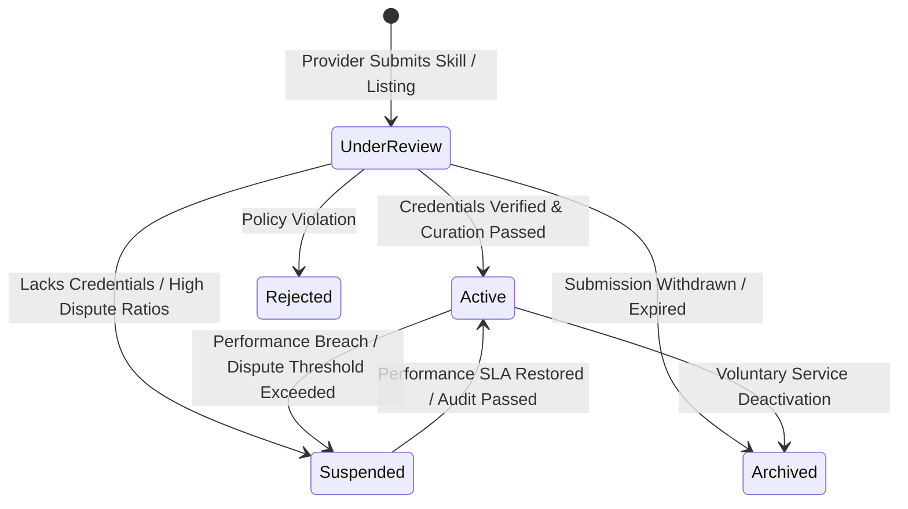
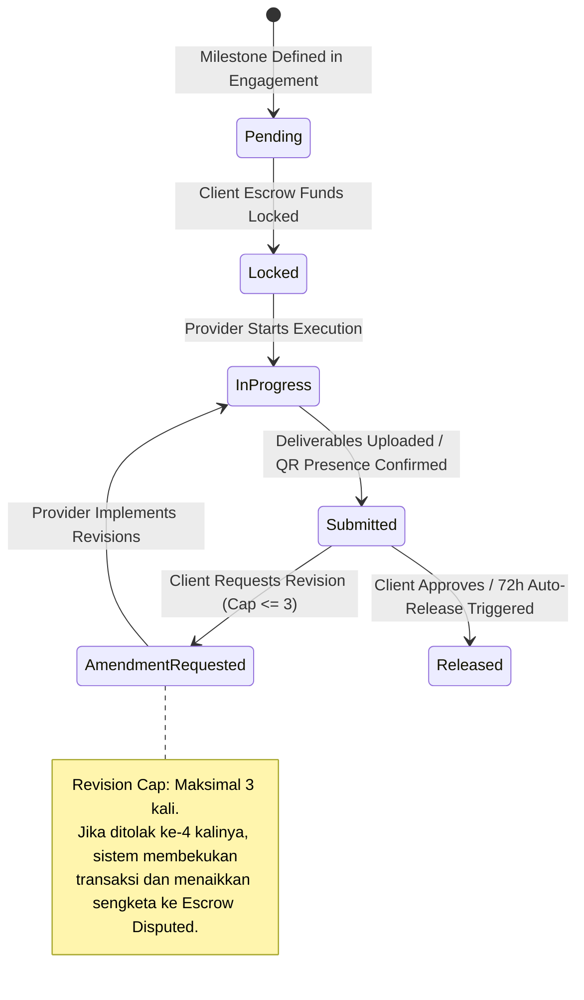
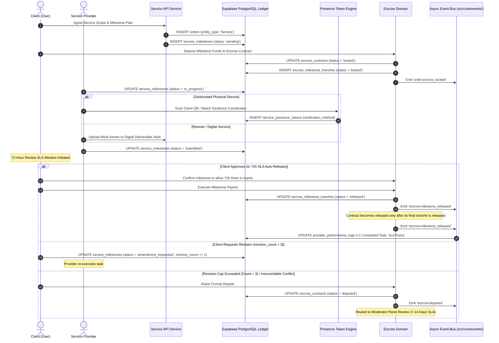

# SERVICE LIFECYCLE MANAGEMENT

Status Document: In review | VERSION: 1.1
Domain Context: Service Domain (Professional & Geolocated Skills Hub)

---

## 1. SERVICE LISTING & ENGAGEMENT STATE MACHINES

Setiap penawaran keahlian dari `ServiceProvider` beserta alur eksekusi tugasnya dikendalikan secara mutlak oleh dua lapisan mesin status terpisah:

### 1.1 Service Listing Lifecycle (`service_listings.status`)


### 1.2 Service Milestone Lifecycle (`service_milestones.status`)
Status termin pengerjaan dikunci pada nilai yang divalidasi oleh database constraint (`check_milestone_status`):


---

## 2. WORKFLOW PENGERJAAN JASA & PENCAIRAN TERMIN

Alur pengerjaan jasa mengintegrasikan koordinasi antara Service Domain, Escrow Domain, Moderation Domain, dan Trust Engine:



---

## 3. BUSINESS CRITERIA & VALIDATION GATES

Tabel `service_listings`, `service_milestones`, dan `service_presence_tokens` menegakkan aturan arsitektur secara programmatik:

### 3.1 Dual-Delivery Method Architecture
*   **Remote / Online Services (`delivery_method = 'Remote'`)**: Pengiriman luaran digital wajib melalui *Digital Deliverable Vault* platform dengan pencatatan *hash* berkas. Tidak memiliki batasan radius geografis.
*   **Geolocated Physical Services (`delivery_method = 'Geolocated'`)**: Wajib menyertakan titik pusat koordinat (`base_location POINT`) dan radius jangkauan operasional fisik (`service_operational_radius_meters INT`). Sistem pencarian menyaring penemuan listing jasa berdasarkan kedekatan jarak koordinat klien terhadap perimeter jangkauan penyedia.

### 3.2 Physical Presence Validation Engine (`service_presence_tokens`)
Bagi jasa dengan kehadiran fisik, pembaruan milestone ke status `Submitted` mewajibkan validasi kehadiran lapangan via salah satu metode terakreditasi:
*   `QR_Scan`: Klien memindai kode QR dinamis berbasis waktu (*time-based OTP QR*) yang ditampilkan di aplikasi penyedia jasa saat tiba di lokasi.
*   `Geofence_Match`: Sistem membandingkan `provider_coordinates` dan `client_coordinates`. Jika selisih jarak (`distance_deviation_meters`) berada di dalam radius toleransi (maksimal 50 meter), validasi disetujui otomatis.
*   `Manual_Moderator_Override`: Jika terjadi kegagalan sinyal GPS/jaringan seluler di lokasi terpencil, pemenuhan kehadiran dapat diajukan ke kurator dengan bukti foto/dokumen fisik.

### 3.3 The Rigid Revision Cap Protection
*   Untuk melindungi penyedia jasa dari manipulasi penambahan lingkup kerja liar (*scope creep*), database memberlakukan *hard check constraint*:
    ```sql
    revision_count INT DEFAULT 0 NOT NULL CONSTRAINT check_revision_cap CHECK (revision_count <= 3)
    ```
*   Jika `revision_count` telah mencapai 3 dan hasil kerja masih ditolak oleh klien, sistem memblokir revisi tambahan. Klien dapat membuka sengketa; Order/Service mengirim perintah ke Escrow, yang membekukan kontrak dan menerbitkan `escrow.disputed`. Eskalasi tiket panel mengikuti `moderation-lifecycle.md`.

---

## 4. PROVIDER PERFORMANCE LEDGER & AUDIT TRAIL

Platform menerapkan transparansi performa historis untuk menjamin standar kepatuhan ekosistem:

### 4.1 SLA Jendela Review 72 Jam (*Auto-Release*)
*   Setelah penyedia jasa mengubah status milestone menjadi `Submitted`, klien memiliki jendela waktu peninjauan selama **72 Jam**.
*   Jika klien pasif dan tidak memberikan persetujuan maupun permintaan revisi dalam batas 72 jam, sistem secara otomatis mengeksekusi event `AutoReleaseTriggered` untuk mencairkan dana termin kepada penyedia jasa.

### 4.2 Provider Performance Tracking (`provider_performance_logs`)
Setiap pengguna yang memegang peran `ServiceProvider` memiliki entitas performa terpusat:
*   `total_completed_tasks`: Akumulasi kuantitas milestone/kontrak yang sukses diselesaikan.
*   `sla_compliance_rate`: Rasio persentase penyelesaian tugas tepat waktu sesuai tenggat (default: 100.00%).
*   `active_dispute_ratio`: Rasio persentase sengketa aktif terhadap total order (ambang batas bahaya: > 5.00%).
*   Metrik performa dievaluasi Governance untuk merekomendasikan ranking atau pembekuan lisensi jasa (`status = 'suspended'` melalui keputusan yang diterapkan oleh owner).

### 4.3 Service Scope Audit Trail (`service_change_logs`)
Setiap mutasi pada parameter lingkup kerja, harga dasar, atau batas geofence wajib dicatat pada tabel `service_change_logs`:
*   `id`: Primary key log unik (`UUID DEFAULT gen_random_uuid()`).
*   `service_id`: UUID listing jasa yang dimodifikasi.
*   `actor_id`: UUID penyedia jasa atau kurator yang mengubah lingkup.
*   `old_scope`: Lingkup dan harga sebelum revisi (`JSONB`).
*   `new_scope`: Lingkup dan harga sesudah revisi (`JSONB`).
*   `timestamp`: Waktu pencatatan mutasi (`TIMESTAMPTZ DEFAULT now()`).

### 4.4 Async Event-Bus Contract
*   `service.submitted`: Diterbitkan saat listing keahlian baru diajukan ke `ServiceQueue`.
*   `service.approved`: Diterbitkan saat kurator menyetujui listing keahlian, membuka penawaran ke publik.
*   `order.escrow_locked`: Diterbitkan saat dana termin jasa berhasil dikunci di escrow contract.
*   `escrow.milestone_released`: Diterbitkan oleh Escrow setelah payout tranche berhasil, memperbarui read model performa dan reputasi.
*   `escrow.disputed`: Diterbitkan saat termin membeku akibat pelanggaran revisi atau konflik pelaksanaan tugas.
## 5. KEPEMILIKAN TRANCHE

`service_milestones.status` hanya merekam progres kerja (`pending`, `in_progress`, `submitted`, `amendment_requested`, `completed`, `cancelled`). Kunci/pencairan dana dimiliki `escrow_milestone_tranches.status` (`locked`, `released`, `refunded`, `disputed`) dan hanya dapat diubah Escrow. Service-Marketplace mengonsumsi event Escrow untuk memperbarui read model; auto-release 72 jam dihitung Escrow sejak tranche terkait menerima submission.
