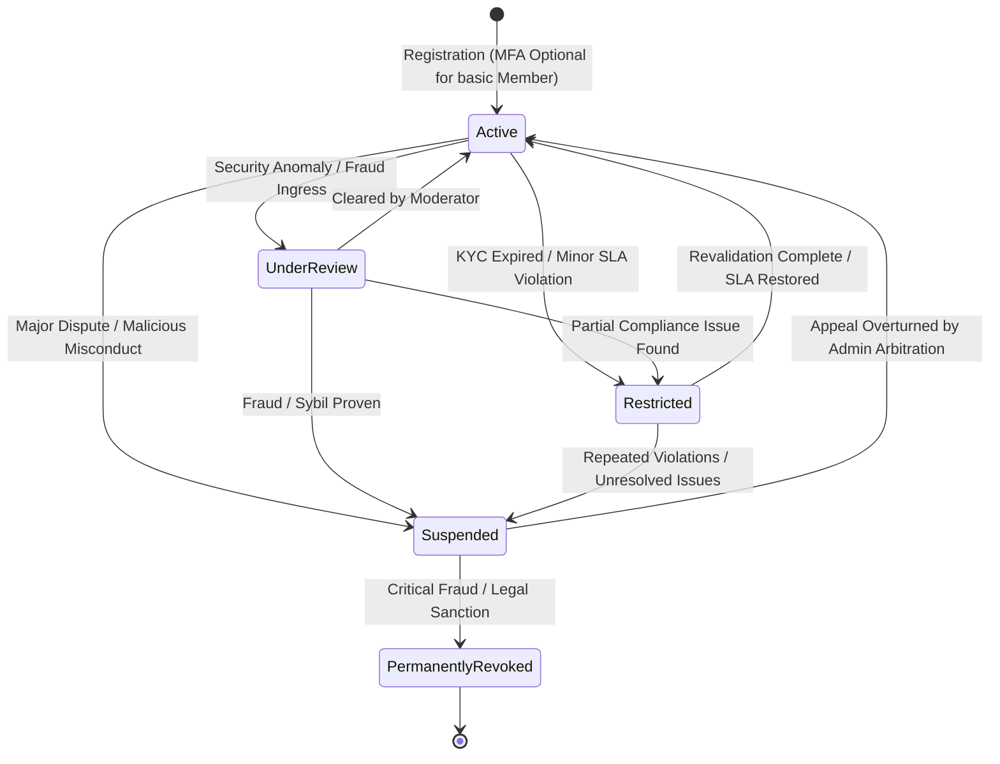
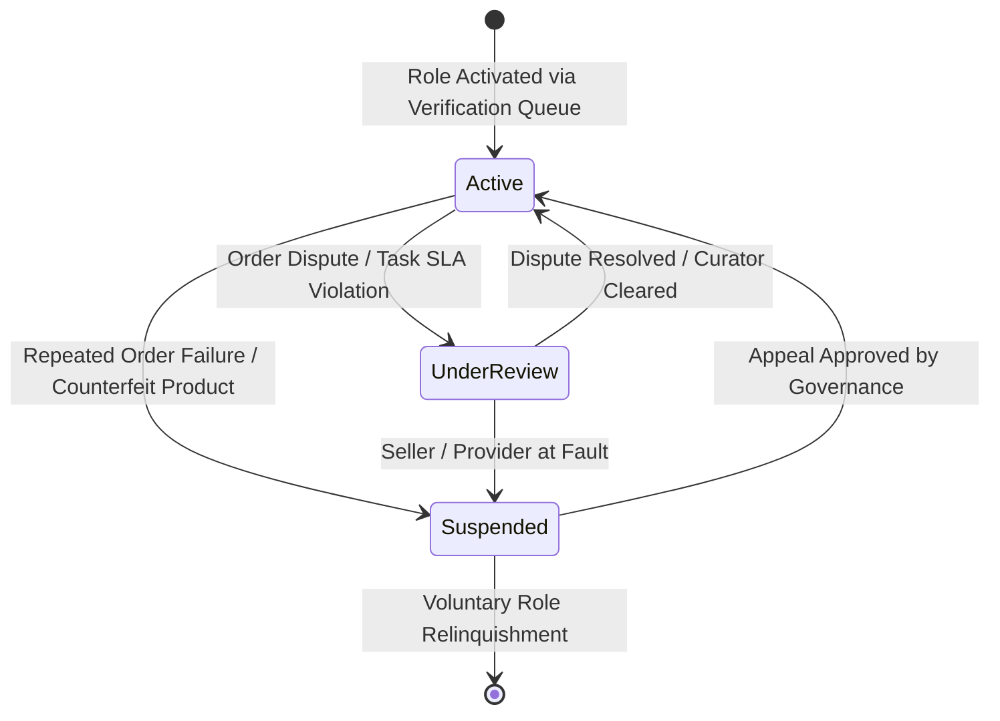

# USER LIFECYCLE MANAGEMENT

Status Document: In review | VERSION: 1.1
Domain Context: Identity Domain (Single Account Policy & Additive Roles)

---

## 1. MASTER IDENTITY STATUS STATE MACHINE (`users.status`)

Setiap jangkar identitas manusia atau organisasi (`user_id`) dikendalikan oleh mesin status global di bawah ini. Perubahan status utama akan berdampak langsung ke seluruh ekosistem peran (*Trust Spillover Protocol*).



### 1.1 Batasan Dampak Operasional Status Global
*   **Active**: Akses penuh ke seluruh fitur platform sesuai dengan peran aditif yang dimiliki. Wajib mengaktifkan MFA (`mfa_enabled = TRUE`) jika memegang peran komersial atau administratif.
*   **UnderReview**: Status pembatasan sementara setelah Security/Moderation event; Identity menerapkannya sesuai aturan. Dampak akses ditentukan melalui status peran dan kontrak terkait, bukan dengan asumsi semua payout diblokir.
*   **Restricted**: Pembatasan akses sesuai lingkup keputusan; pengguna tidak dapat membuat listing/order baru sebagaimana ditentukan. Escrow menahan payout hanya bila ada dasar sengketa/compliance yang sah.
*   **Suspended**: Penangguhan sesuai durasi keputusan. Mesin aturan hanya boleh menerapkan freeze sementara; pemulihan akun dilakukan Admin Governance.
*   **PermanentlyRevoked**: Pencabutan permanen hanya dengan keputusan Admin pada `governance_decisions`. Identitas/PII ditangani sesuai retensi dan anonimisasi, bukan blacklist biometrik.

---

## 2. GRANULAR ROLE LIFECYCLE (`roles.status`)

Sesuai dengan *Additive Role Model*, sanksi operasional dapat diisolasi ke peran spesifik tanpa mematikan akun utama secara keseluruhan:



*   **Prinsip Isolasi Peran**: Jika peran `Seller` dibekukan (`user_roles.status = 'suspended'`) karena keterlambatan logistik, pengguna tetap memiliki akses `active` sebagai `member` (membaca, berdiskusi sosial, dan belanja retail) serta tetap dapat menulis artikel sebagai `author`, kecuali terjadi pelanggaran sistemik yang memicu penurunan `users.status`.

---

## 3. ADDITIVE ROLE UPGRADE LIFECYCLE

Pengguna dilarang memiliki multi-akun. Peningkatan kapabilitas komersial atau publikasi wajib menggunakan alur pengajuan peran aditif pada akun master tunggal yang sama:

```mermaid
sequenceDiagram
    autonumber
    actor User as Member (User)
    participant API as Gateway / Identity Service
    participant Queue as Moderation Tickets (IdentityQueue)
    participant Mod as Moderator / Admin Panel
    participant DB as Supabase PostgreSQL Ledger
    participant Audit as identity_audit_logs

    User->>API: Submit Role Upgrade (Attach KYC/KYB & Certs)
    API->>DB: Check MFA & Existing Role State
    API->>Queue: Enqueue Ticket (tier_level, documents_hash)
    Note over Queue: Status: UnderReview
    Mod->>Queue: Inspect Documents & Audit Compliance
    alt Curation Approved
        Mod->>Bus: Emit 'moderation.decision_made' (recommendation)
        Note over API: Moderator merekomendasikan; Admin mengesahkan KYC/KYB
        API->>DB: Identity Service updates roles and verifications after Admin approval
        Mod->>Audit: INSERT identity_audit_logs ('RoleActivated')
        API-->>User: Notification: Role Successfully Activated
    else Curation Rejected / Revision Needed
        Mod->>Bus: Emit 'moderation.decision_made' (recommendation)
        Note over API: Identity applies final result only after Admin decision
        Mod->>Audit: INSERT identity_audit_logs ('RoleRejected')
        API-->>User: Notification with Feedback Notes
    end
```

### 3.1 Role Activation Rules
1.  **Baseline Registration**: Setiap pengguna baru secara otomatis memegang peran dasar `Member`.
2.  **Upgrade Request Trigger**: Saat `Member` mengajukan peran baru, sistem membuat tiket di `moderation_tickets` dengan kategori `IdentityQueue`.
3.  **Verification Gate Parameter**:
    *   **Tier 1 (Member)**: Validasi email aktif, SMS/OTP telepon seluler, opsional MFA.
    *   **Tier 2 (Author / Seller / ServiceProvider)**: Wajib meloloskan verifikasi identitas personal (KYC), portofolio/sertifikasi keahlian profesional (khusus ServiceProvider), dan **wajib mengaktifkan MFA**.
    *   **Tier 3 (Distributor)**: Wajib meloloskan validasi legalitas badan usaha (KYB: NIB, NPWP, Akta), **wajib mengaktifkan MFA**, serta mendaftarkan minimal 1 perwakilan manusia akuntabel (`organization_representatives`).
4.  **Administrative Isolation Boundary**: Jika akun terdaftar memegang peran `Moderator` atau `Admin`, sistem secara otomatis memblokir pengajuan peran komersial (`Seller`, `Distributor`, `ServiceProvider`) pada kontainer akun tersebut demi mencegah benturan kepentingan (*Conflict of Interest Lockout*).

---

## 4. REPUTATION INTERACTION & INACTIVITY DECAY

Siklus hidup akun terhubung erat dengan *Trust & Reputation Domain*:

1.  **Skor Awal Akun**: Akun baru memperoleh skor awal `100` pada `core_reputations.master_score` (rentang 0–1000; minimum 0).
2.  **Trust Spillover**: Skor master memengaruhi ranking lintas ekosistem. Pembatasan kapabilitas tetap mengikuti `roles.status`/`users.status` dan keputusan Governance; penalti tidak otomatis menonaktifkan semua peran.
3.  **Inactivity Auto-Decay**: Akun yang tidak melakukan aktivitas valid selama **> 6 bulan berturut-turut** akan terkena penalti penurunan skor bertahap yang dicatat pada tabel `reputation_decay_logs`.

---

## 5. AUDIT TRAIL INFRASTRUCTURE

Setiap mutasi status identitas (`users.status`) atau penambahan/perubahan peran (`roles.status`) wajib meninggalkan jejak forensik sesuai retensi yang ditetapkan.

*   **Pencatatan Log**: Wajib menulis entri baru ke tabel `identity_audit_logs`.
*   **Skema Kolom Sesuai Database Ledger**:
    *   `id`: Primary key log unik (`UUID DEFAULT gen_random_uuid()`).
    *   `user_id`: UUID pengguna target yang mengalami perubahan.
    *   `actor_id`: UUID pengguna/admin/sistem yang mengeksekusi mutasi.
    *   `action_type`: Tipe tindakan (`RoleRequested`, `RoleActivated`, `RoleSuspended`, `StatusRestricted`, `StatusSuspended`, `RevalidationExpired`).
    *   `old_value`: Rekaman status/peran sebelumnya (`JSONB`).
    *   `new_value`: Rekaman status/peran sesudahnya (`JSONB`).
    *   `rationale_code`: Kode alasan/kebijakan standar tata kelola.
    *   `timestamp`: Waktu pencatatan mutasi (`TIMESTAMPTZ DEFAULT now()`).
*   **Anti-Bypass Mandate**: Operasi modifikasi log identitas dilindungi oleh fungsi penahan database *append-only*. Perintah `UPDATE` atau `DELETE` pada tabel log ini dilarang keras dan akan digagalkan oleh *trigger* integritas database.


## 6. KETENTUAN REVISI (ADR-001 D4, D6, D7, D8)
* Perubahan `users.status`/`roles.status` hanya oleh Identity Service atas keputusan dan event kontraktual; nilai database menggunakan `lowercase_snake_case`.
* Verifikasi KYC/KYB: Moderator (IdentityQueue) merekomendasikan, Admin mengesahkan.
* `identity.status_restricted` dikonsumsi Escrow, Order, Marketplace, Service, dan Content untuk mengevaluasi akses masing-masing tanpa mutasi lintas domain.
* Skor reputasi minimum 0; skor awal 100. Penalti reputasi tidak menentukan sanksi akun secara otomatis.


---
